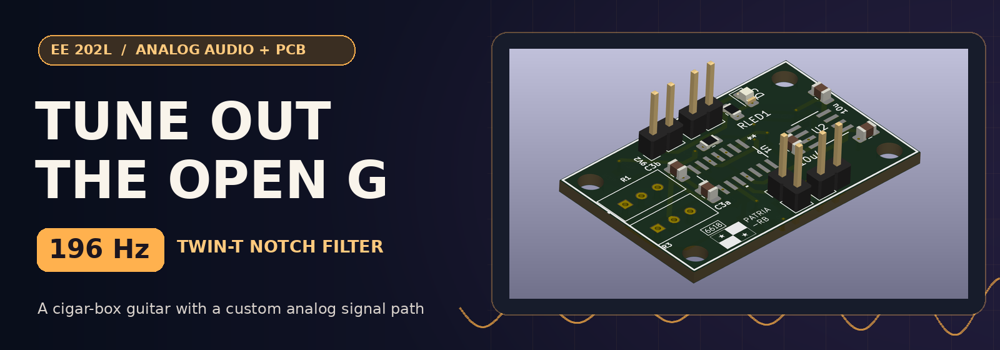
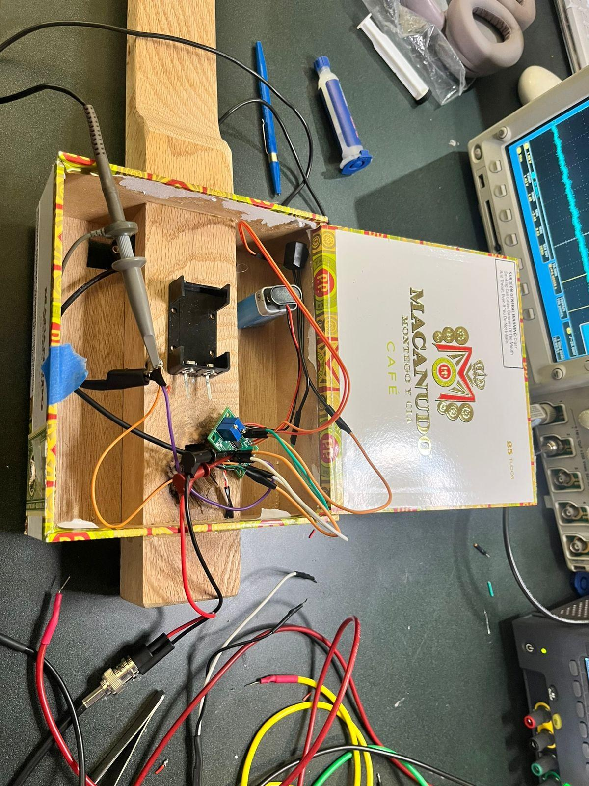
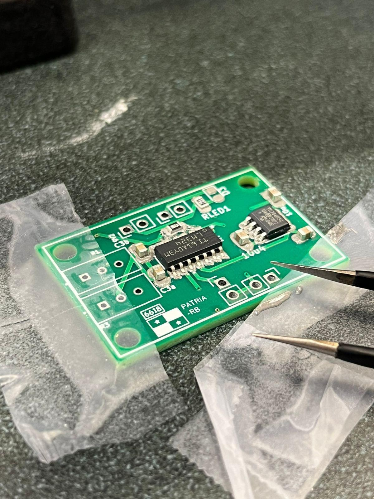
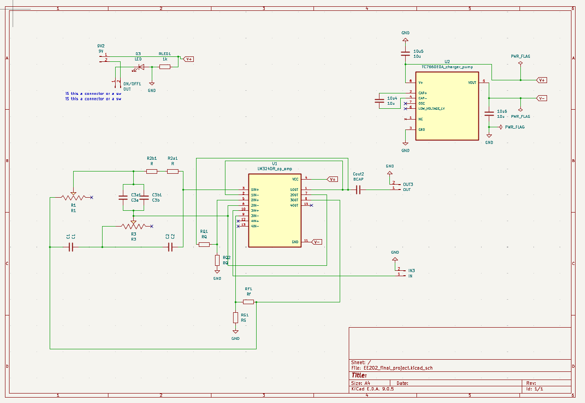
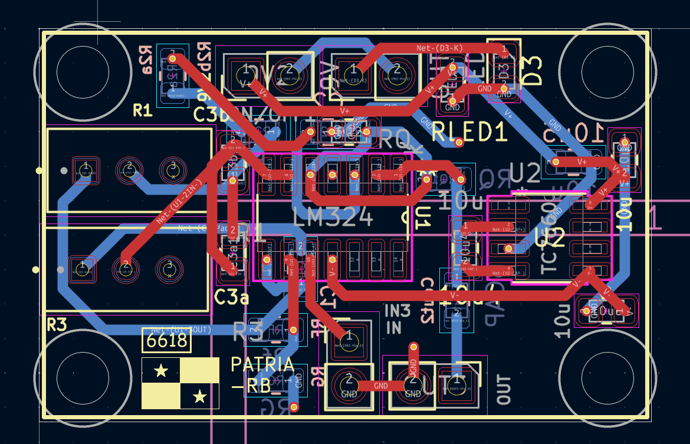
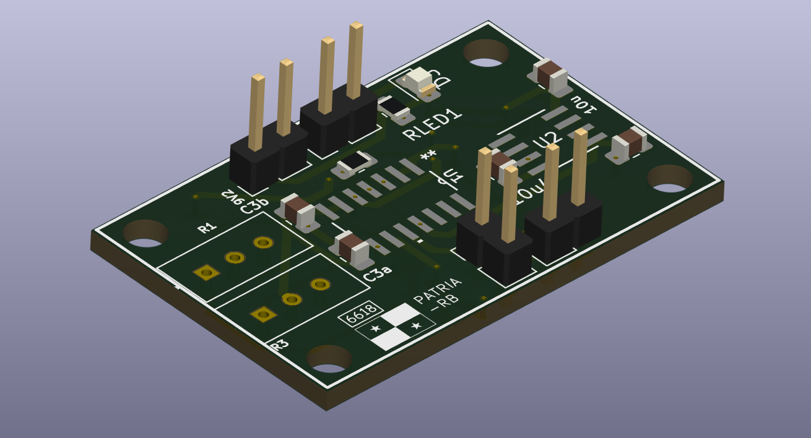
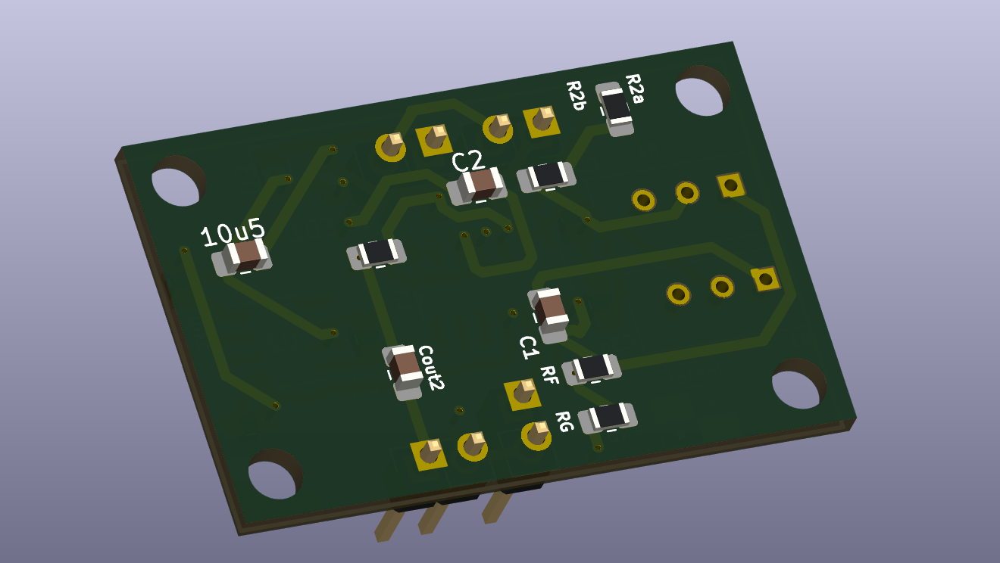
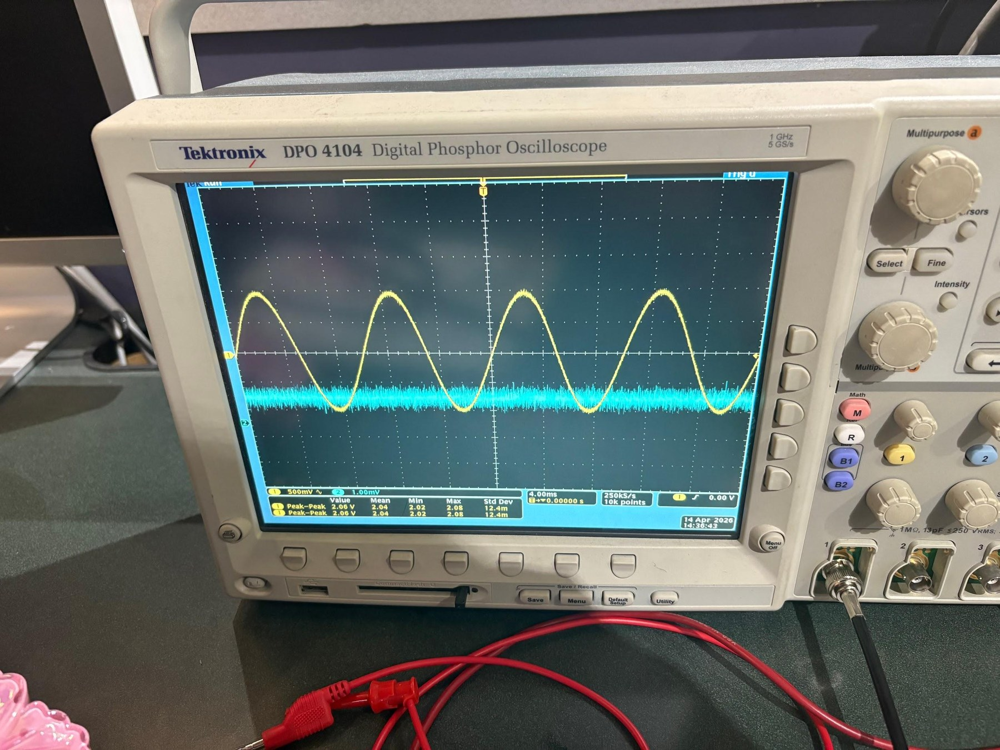

# 🎸 Cigar-Box Electric Guitar | 196 Hz Notch Filter

  <strong>Analog filter design · Custom PCB · SMD and through-hole assembly · Bench debugging</strong>

We built a six-string cigar-box electric guitar with a custom analog PCB designed to suppress the **open G string at 196 Hz**. The circuit uses a tunable **active twin-T notch filter**; the guitar pickup feeds the board, and the filtered signal goes to an output jack and speaker. This was an EE 202L project by **Paula Arias and Lucia Miles**.

> **The short version:** We calculated the filter, simulated it in LTspice, tested it on a breadboard, laid out and assembled a KiCad PCB, then diagnosed and repaired a missing capacitor on the fabricated board. The final guitar audibly suppressed the target note. Its selectivity was lower than our original calculation, and the report does not give a measured attenuation in dB.

**Explore:** [The build](#-the-build) · [Signal path](#-how-the-circuit-works) · [The repair](#-the-repair) · [Design files and photos](#-open-the-lab-notebook) · [Results](#-what-we-verified)

## 📸 The build

| Guitar internals during testing | Hand-assembled PCB |
| :--: | :--: |
|  |  |
| *The pickup, power wiring, switch, LED and output jack inside the box.* | *Mixed SMD and through-hole hardware on the custom PCB.* |

The body is a cigar box with a shaped wooden neck, six strings, a pickup, an output jack, and a power switch with an LED indicator. The PCB lives inside the body. The pictures above show the internal build and board assembly; they are not photos of the guitar's exterior.

## 🎚️ How the circuit works

The twin-T network rejects a band centered near **196 Hz**, the fundamental of an open G3 string. Positive feedback adjusts the filter's quality factor, while potentiometers let us tune the notch. Unity-gain buffers isolate circuit sections. An **LM324** provides the op-amp stages, and a **TC7660 charge pump** derives a negative rail from the **9 V supply** for the analog signal path.

| Design choice | Why it matters |
| --- | --- |
| **196 Hz target** | Aligns the notch with the open G3 fundamental. |
| **0.22 µF capacitors** | Starting point for the calculated twin-T component values. |
| **≈3.8 kΩ and ≈1.845 kΩ nominal resistances** | Calculated values for the target notch; trimmers support tuning in the assembled circuit. |
| **KiCad + LTspice** | PCB layout and circuit simulation before assembly. |

<strong>🔍 What does “notch filter” mean here?</strong>

A notch filter attenuates a narrow range of frequencies while allowing frequencies outside that range through. We designed this one around the **196 Hz fundamental** of the open G string. A real plucked string also has harmonics, so filtering its fundamental is different from deleting every part of the note. The finished filter worked audibly, but its measured quality factor was lower than planned. We do not have a quantified sweep or dB measurement to publish here.

## 🛠️ The repair

The fabricated PCB was missing a capacitor needed by the filter. During bring-up, we traced the behavior with an oscilloscope, compared the board against the schematic, and added the component by manually exposing and modifying the relevant copper. We also reworked solder joints and checked for shorts. After the repair, the guitar produced the intended audible suppression of the G string.

<strong>🧪 Open the bring-up checklist</strong>

1. Calculate a 196 Hz notch using the available component values.
2. Simulate the response in LTspice and test the stages on a breadboard.
3. Route the PCB in KiCad with attention to placement and grounding.
4. Assemble SMD and through-hole parts, then inspect and rework joints.
5. Verify the supply rails and LED, inspect waveforms, and listen to the output.
6. Diagnose the missing capacitor, repair the board, and retest.

## 🗂️ Open the lab notebook

<strong>01 · View the schematic</strong>

The image shows the designed circuit. The native KiCad files are not included in this README package.

<strong>02 · Explore the routed board and 3D views</strong>

| Copper routing | KiCad 3D front |
| :--: | :--: |
|  |  |

<strong>03 · See the oscilloscope check</strong>

We used the oscilloscope during breadboard and final hardware testing, and a multimeter to verify power delivery.

## ✅ What we verified

- **Built a working instrument:** the pickup, switch, LED, PCB, output jack, and speaker formed a functioning signal path.
- **Suppressed the intended note:** the final system audibly reduced the open G string after the PCB repair.
- **Learned where theory met hardware:** the observed quality factor was lower than predicted; there is no published measured frequency sweep or exact attenuation figure.

**Tools and components:** KiCad · LTspice · LM324 · TC7660 · twin-T filter · oscilloscope · multimeter · SMD and through-hole soldering.

Project: EE 202L, May 2026 · Built by Paula Arias and Lucia Miles · Images extracted from the team lab report.

[← Back to Paula's featured hardware projects](../README.md#-featured-hardware-projects)
